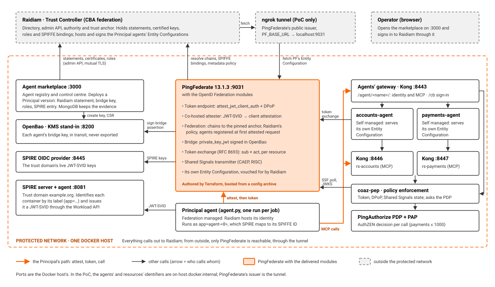

# Agentic IDAM PoC architecture

The PoC rig as built: no agent provider, Raidiam as the Trust Controller, PingFederate as the bank's authorisation
server.

Agents are registered in an agent marketplace, identified through OpenID Federation with Raidiam as the Trust
Controller, attested on SPIRE's word, and given sender-constrained tokens by PingFederate. A gateway and a policy
decision point check every call, and Shared Signals carry lifecycle events to enforcement within seconds.

Everything runs in one protected network, a single Docker host in the PoC. It calls out to Raidiam, and nothing
outside can call in except PingFederate, through its public issuer.

For Confluence: open [`docs/architecture/poc-architecture.html`](docs/architecture/poc-architecture.html) in a
browser, use **Copy page for Confluence**, paste, and upload
[`poc-rig-architecture.png`](docs/architecture/poc-rig-architecture.png) (or the `.svg`) for the diagram.

## The rig

*Components and the calls between them. The orange path is a Principal agent's: get attested, get a token, call a
resource or another agent.*

## Trust boundaries

- **Raidiam (external)** is the single source of who an agent is and what it may do: its software statement,
  certified keys, roles (the capability envelope) and SPIFFE binding. Every party trusts an agent only through a chain
  to Raidiam's pinned trust anchor.
- **The protected network** holds PingFederate, the agents, the resources, the gateways and the PDP, SPIRE, OpenBao and
  the marketplace. It makes outbound calls only: Raidiam lists and vouches for its entities, but cannot fetch them.
- **PingFederate's issuer is public** (the ngrok tunnel in the PoC). Raidiam and other federation members fetch
  PingFederate's Entity Configuration from it, and PingFederate's token endpoint trusts its own attester by fetching it
  there too.

## Components

| Layer | Component | Role in the PoC | Port |
|---|---|---|---|
| Trust | Raidiam | Trust Controller: directory, admin API, authority and trust anchor. Hosts and signs the Principal agents' Entity Configurations; publishes keys, roles and SPIFFE bindings as signed statements and metadata policy; stops vouching for a suspended agent | external |
| Identity | PingFederate 13.1.3 + OpenID Federation modules | The bank's authorisation server. Issues every token, DPoP-bound to the agent's instance key, for one resource. Attests agent instances, resolves and registers agents from their chains, signs bridge assertions in OpenBao, exchanges tokens between agents and transmits Shared Signals | 9031 |
| Keys | OpenBao | Stands in for the bank's KMS. Holds each agent's bridge key in its transit engine, never exported. The marketplace may only create keys and get CSRs; PingFederate may only sign | 8200 |
| Workload identity | SPIRE server and agent | Trust domain `example.org`. Identifies each container by its `app` label and issues it a JWT-SVID | 8081 |
| Workload identity | SPIRE OIDC provider | Serves the trust domain's live JWT-SVID keys, which PingFederate's attester verifies against | 8445 |
| Agents | Principal agent | Federation managed: Raidiam hosts its identity. Runs per job under its version's label, gets attested, reads its envelope, finds resources and agents by capability, and calls them | - |
| Agents | accounts-agent, payments-agent | Self managed sub-agents: each serves its own Entity Configuration, accepts calls from the Principal, exchanges the Principal's token and calls its own resource | behind 8443 |
| Edge | Agents' gateway (Kong) | One origin for the sub-agents' identities and MCP, and the marketplace's Raidiam sign-in callback | 8443 |
| Resources | rs-accounts, rs-payments behind Kong | MCP resource servers and federation entities. Check the token again, and every party's chain and capability in Raidiam | 8446, 8447 |
| Enforcement | coaz-pep | Policy enforcement point for every MCP call: token signature, audience, expiry, DPoP proof and replay, Shared Signals state. Asks the PDP and logs each decision with its principal and reason | - |
| Enforcement | PingAuthorize PDP and PAP | Decides each call through AuthZEN on its action, arguments and context, for example denying payments over 1000. Policy authored through the PAP's API | 8448 (PAP) |
| Control | Agent marketplace + MongoDB | Agent registry and control centre. Deploys, suspends and reinstates Principal versions, runs scenarios, and keeps hash-chained evidence for each objective | 3000 |

[`demo/COMPONENTS.md`](demo/COMPONENTS.md) has every component in more detail.

## Who trusts what

| Party | Trusts | Because |
|---|---|---|
| PingFederate | An agent and its capabilities | Its chain resolves to the pinned Raidiam anchor, and Raidiam's metadata policy carries its envelope and bridge key |
| PingFederate | An attestation | The attester (PingFederate's own) resolves through the federation, and its key is in PingFederate's Entity Configuration |
| PingFederate's attester | A workload is an instance of an agent | Its JWT-SVID verifies against SPIRE's live keys, and Raidiam's SPIFFE binding for that agent names that SPIFFE ID and PingFederate |
| Gateways, PEP, resources | A call | The token is PingFederate's, for this resource, unexpired and DPoP-bound to the caller's instance key; no Shared Signal has disabled the agent; the PDP permits; Raidiam still vouches for every party |
| Agents | A resource or another agent | Its chain resolves to the same pinned anchor, and its metadata says it serves the needed capability, protected by PingFederate |

## How an agent's identity is hosted

| | Federation managed | Self managed |
|---|---|---|
| In the PoC | Principal agents, created by the marketplace | accounts-agent, payments-agent, the two resources |
| Entity Identifier | Raidiam's: `https://rp.directory.cba.raidiam.io/openid_relying_party/<statement id>` | The statement's `ClientId`, an HTTPS URL the entity serves |
| Entity Configuration | Served and signed by Raidiam | Served by the entity, signed with its own entity key |
| Keys certified by Raidiam | One: the bridge key, created in OpenBao | Two: entity key and bridge key |
| Who can resolve it | Anyone | Only those who can reach it: inside the protected network |

[README.md](README.md), "Setting up agents in Raidiam", says how to set up each.

## Main flows

### Deploying a Principal version

1. The operator approves a Principal version in the marketplace.
2. The marketplace creates a Federation managed software statement in Raidiam. Raidiam gives it its identifier and
   hosts its Entity Configuration.
3. It adds the SPIFFE binding to the statement: `spiffe://example.org/agent-<first 8 characters of the statement id>`,
   SPIRE's key endpoint, and PingFederate as its attester.
4. It creates the agent's bridge key in OpenBao. OpenBao makes and signs the CSR, and Raidiam certifies it.
5. It adds the agent's roles (its capability envelope) and a SPIRE entry for its workload label, then waits until
   Raidiam vouches for it. Nothing is registered in PingFederate.

### An attested token request

1. The agent's container gets a JWT-SVID from SPIRE, addressed to PingFederate.
2. It asks PingFederate's attester for a client attestation. The attester checks the SVID against SPIRE's live keys,
   and against the binding Raidiam publishes for the agent.
3. The agent calls PingFederate's token endpoint with the attestation and a DPoP proof (`attest_jwt_client_auth`).
4. PingFederate trusts the attester through its federation chain. If it has not seen the agent, it resolves the agent's
   chain to Raidiam's anchor and registers it.
5. PingFederate signs a bridge `private_key_jwt` for the agent with its key in OpenBao, and issues an access token for
   one resource, bound to the instance key.

### Agents calling agents

1. The Principal finds the Accounts or Payments agent by capability through the federation, and calls its MCP endpoint
   through the agents' gateway and the PEP.
2. The sub-agent, attested under its own SPIFFE ID, exchanges the Principal's token at PingFederate (RFC 8693): `sub`
   stays the Principal, `act` names the sub-agent.
3. It calls its resource with the new token, bound to its own instance key. The resource's gateway, the PEP and the PDP
   check the call, and the resource checks both agents' chains in Raidiam.

### Suspending an agent

1. The operator suspends a version in the marketplace.
2. Raidiam's statement becomes `Suspended`, and its authority stops vouching for the agent.
3. PingFederate's transmitter raises a Shared Signals `account-disabled` event. The PEP picks it up within a poll and
   refuses the agent's tokens.
4. Reinstating reverses both.

[`demo/flows.md`](demo/flows.md) has each objective's flow as a sequence diagram.

## What is PoC-only

The rig demonstrates the trust model; these are its shortcuts, each with a production equivalent in
[`demo/raidiam/PROTECTED-ENVIRONMENTS.md`](demo/raidiam/PROTECTED-ENVIRONMENTS.md):

- One Docker host, with identifiers on `host.docker.internal` and the rig's own certificate authority.
- An ngrok tunnel as PingFederate's public issuer.
- PingFederate in its development profile, as a single node with in-memory state.
- OpenBao unsealed with a key kept on disk; the sub-agents' keys in files.
- The marketplace driving Docker through its socket, and an operator's Raidiam session kept in an unauthenticated
  MongoDB.
- Raidiam's admin API used with an operator's session until it allows client credentials.

Deploying on AWS: [`AWS.md`](AWS.md).
