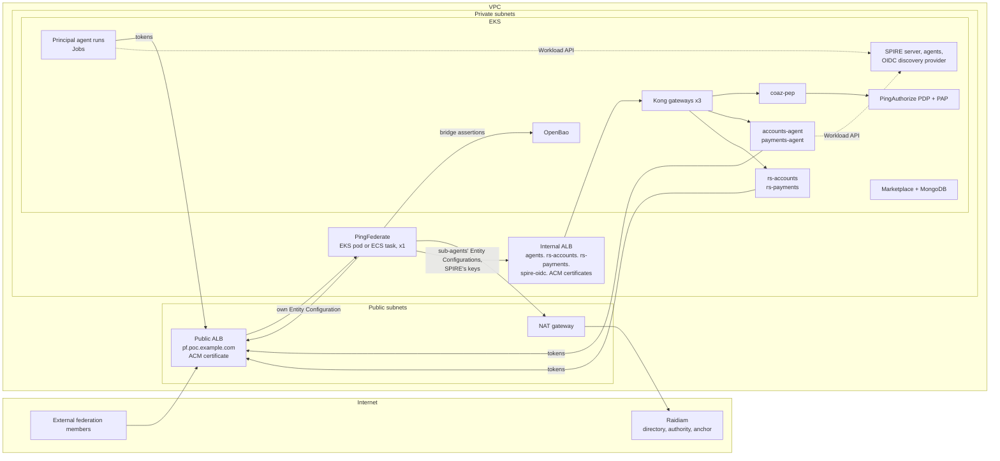

# Deploying the PoC on AWS

How to move this bundle from Docker Compose on one machine to AWS: the agents and their supporting services on
**Amazon EKS**, and PingFederate on **EKS** or on **Amazon ECS (Fargate)**. The bundle runs as it is with
`./rig.sh up`; this guide maps each piece onto AWS and says what has to change on the way.

**Status:** this is a mapping of the tested Compose deployment, not a deployment that has itself been run end to
end on AWS. The PoC's flows, settings and ordering are unchanged. Five things in the bundle assume Docker on one
host and must change ("Read this first"). One of them, the marketplace driving Docker, is code to port.

## Read this first: what assumes Docker

| In the bundle | Why it does not carry over | On AWS |
|---|---|---|
| Every identifier is on `host.docker.internal` (`https://host.docker.internal:8443/agent/accounts-agent`, `:8446`, `:8447`, `:8445/keys`) | A Docker Desktop name, reachable only from that machine | Real DNS names under a domain you own, e.g. `agents.poc.example.com`. **A Raidiam `ClientId` cannot be changed**, so the sub-agents and the resources need **new software statements** with the new identifiers (step 1) |
| The PoC's own CA (`demo/keys/pf-runtime-tls-ca.*`): every gateway's and PingFederate's certificate, a trust store mounted over PingFederate's `cacerts`, `PF_CA_FILE` in every agent | A private CA nobody else trusts | Public certificates from **ACM** on the load balancers. PingFederate's JVM and the agents trust them with no extra CA, so the trust store and `PF_CA_FILE` are needed only for anything you keep on a private CA |
| SPIRE attests nodes with `x509pop` and workloads by **Docker container label** (`docker:label:app:<name>`) | No Docker socket on EKS nodes | SPIRE's Kubernetes attestors: `k8s_psat` for nodes, `k8s` for workloads, selecting by **pod label** (`k8s:pod-label:app:<name>`) - the same label names (step 4) |
| The **marketplace drives Docker** through `/var/run/docker.sock`: it creates SPIRE entries with `docker exec`, runs a Principal version as a container (`docker create` / `start`), and reads PingFederate's and the PEP's logs for evidence (`demo/marketplace/src/rig.js`, `evidence.js`) | No Docker socket, and the agents are pods | **Port** `rig.js` to Kubernetes, or run the marketplace on one EC2 Docker host (step 9) |
| `ISSUER_HOST_OVERRIDE=host.docker.internal:9031`: the agents reach PingFederate on the Docker host while its issuer is the ngrok name | No tunnel on AWS: the issuer *is* PingFederate's address | **Unset it**; the agents call the issuer directly |

Unchanged on AWS, and still required:
- **PingFederate's issuer is public and reachable from PingFederate itself.** Raidiam and other federation members
  fetch PingFederate's Entity Configuration from it, and PingFederate's token endpoint trusts its own attester by
  fetching its own Entity Configuration there (README, "Prerequisites").
- **One PingFederate.** In the bundle's development profile, its attestation, registration and Shared Signals state
  is in memory: run exactly one task or pod. More needs Redis and a database (see "Towards production").
- **Raidiam is reached outbound** - a NAT gateway for the private subnets.

## Target architecture



| Component | Compose service | AWS home | Exposure | Example name |
|---|---|---|---|---|
| PingFederate | `pingfederate` (`demo/`) | EKS Deployment (1 replica) **or** ECS Fargate service (1 task) | Public ALB, HTTPS to 9031. Admin 9999 never public | `pf.poc.example.com` |
| Agents' gateway (Kong) | `gateway-agents` | EKS Deployment | Internal ALB (public if external agents call them) | `agents.poc.example.com` |
| Resource gateways (Kong) | `gateway`, `gateway-payments` | EKS Deployments | Internal ALB | `rs-accounts.poc.example.com`, `rs-payments.poc.example.com` |
| Sub-agents | `accounts-agent`, `payments-agent` | EKS Deployments | ClusterIP, behind `gateway-agents` | - |
| Resources | `rs-accounts`, `rs-payments` | EKS Deployments | ClusterIP, behind their gateways | - |
| PEP | `coaz-pep` | EKS Deployment | ClusterIP | - |
| PDP and PAP | `pingauthorize`, `pingauthorize-pap` | EKS Deployments | ClusterIP; the PAP through `kubectl port-forward` | - |
| SPIRE | `spire/` | EKS, SPIRE's Helm chart: server StatefulSet, agent DaemonSet | Internal | - |
| SPIRE OIDC discovery provider | `spire-oidc` | EKS, from the same chart | Internal ALB - PingFederate fetches SPIRE's keys from it | `spire-oidc.poc.example.com` |
| OpenBao | `openbao` | EKS StatefulSet with an EBS volume | ClusterIP (internal NLB if PingFederate runs on ECS) | - |
| Marketplace | `marketplace`, `marketplace-mongo` | EKS (after the port) or one EC2 Docker host; MongoDB as a StatefulSet or Amazon DocumentDB | Internal ALB or VPN | `marketplace.poc.example.com` |
| A Principal version's runs | `agent` (`docker compose run`) | Kubernetes Jobs | - | - |

Internal names live in a Route 53 **private** hosted zone for `poc.example.com`; ACM public certificates still cover
them, because ACM validates the domain, not where the name resolves. If anything outside the VPC must reach an agent
or a resource, give it a public ALB instead.

## Before you start

- An AWS account and a Route 53 public hosted zone for your domain, plus a private hosted zone for the same domain
  associated with the VPC.
- `aws`, `eksctl` (or Terraform), `kubectl`, `helm`, `docker`, and the bundle's own tools (README, "Prerequisites"),
  on a workstation or a CI runner. The PingFederate configuration is still authored there, with Terraform against a
  local authoring PingFederate, exactly as `./rig.sh` does.
- An ACM certificate for `*.poc.example.com` in the region.
- Ping licences: a `pingfederate.lic` for PingFederate 13.1 (README, "Licensing PingFederate") and DevOps credentials
  or licences for PingAuthorize.
- The Raidiam access the README asks for.

## 1. Choose the names, and register them in Raidiam

Decide every identifier first: they are baked into PingFederate's configuration and into Raidiam, and Raidiam's
`ClientId`s are permanent.

| `poc.env` | Compose value | AWS value (example) |
|---|---|---|
| `PF_BASE_URL` | the ngrok URL | `https://pf.poc.example.com` |
| `RAIDIAM_PROVIDER_ID` (the sub-agents' origin) | `https://host.docker.internal:8443` | `https://agents.poc.example.com` |
| `RAIDIAM_RESOURCE_ID` | `https://host.docker.internal:8446` | `https://rs-accounts.poc.example.com` |
| `RAIDIAM_PAYMENTS_RESOURCE_ID` | `https://host.docker.internal:8447` | `https://rs-payments.poc.example.com` |
| `TRUST_DOMAIN` | `example.org` | yours, e.g. `poc.example.com` |
| SPIRE's bundle endpoint (in every SPIFFE binding) | `https://host.docker.internal:8445/keys` | `https://spire-oidc.poc.example.com/keys` |

In Raidiam, as in the README's "Setting it up", step 2, but with these values:
- **PingFederate's authorisation server record:** `Issuer` = the new `PF_BASE_URL`. Raidiam fetches its discovery
  document when you save it, so do this once PingFederate answers there (after step 5 or 6).
- **New Self managed statements** for the two sub-agents (`<RAIDIAM_PROVIDER_ID>/agent/accounts-agent`, `.../payments-agent`)
  and the two resources, with their roles, CSRs (`./rig.sh keys` and `./rig.sh csrs` - the keys can be the ones you
  already have) and API resources whose `resource` is the new `ClientId`.
- **SPIFFE bindings** on the sub-agents' statements with the new trust domain and bundle endpoint:
  `spiffe://poc.example.com/accounts-agent`, `spiffe_trust_domain` `poc.example.com`, `spiffe_bundle_endpoint`
  `https://spire-oidc.poc.example.com/keys`, `client_attesters` `["https://pf.poc.example.com"]`. Still at most 255
  characters.
- **The marketplace's directory client:** add the redirect URI `https://agents.poc.example.com/cb` (Kong routes `/cb`
  to the marketplace).

Principal versions are made later by the marketplace, with the new values (step 9).

## 2. Network and cluster

```sh
eksctl create cluster --name agentic-poc --region ap-southeast-2 --version 1.31 \
  --nodegroup-name workers --node-type m6i.xlarge --nodes 3 --node-private-networking --with-oidc
```

Then install, by their own instructions:
- the **AWS Load Balancer Controller** (Ingress to ALB, Service to NLB);
- the **EBS CSI driver** (volumes for SPIRE, OpenBao and MongoDB);
- optionally **ExternalDNS** (Route 53 records from Ingress hosts) and the **External Secrets Operator** (Secrets
  Manager to Kubernetes Secrets).

PingAuthorize and PingFederate want memory: give the nodes 16 GB or more each, or a node group of their own.
Allow the node and ECS security groups to reach each other on the service ports, and egress to the internet through
the NAT gateway.

## 3. Build the images and push them to ECR

```sh
export ECR=<account>.dkr.ecr.<region>.amazonaws.com
aws ecr get-login-password | docker login --username AWS --password-stdin $ECR
for r in pingfederate agent-workload kong coaz-pep pingauthorize marketplace; do aws ecr create-repository --repository-name agentic-poc/$r; done

docker build -t $ECR/agentic-poc/agent-workload:poc demo/spire-workload        # sub-agents, resources, Principal runs
docker build -t $ECR/agentic-poc/kong:poc           demo/gateway/kong
docker build -t $ECR/agentic-poc/coaz-pep:poc       demo/gateway/coaz-pep
docker build -t $ECR/agentic-poc/pingauthorize:poc  demo/gateway/pingauthorize
docker build -t $ECR/agentic-poc/marketplace:poc    demo/marketplace
docker push ...                                                                 # each of them
```

One image, `agent-workload`, serves `accounts-agent`, `payments-agent` (`python sub_agent.py`), `rs-accounts` and
`rs-payments` (`python rs_accounts.py`) and the Principal runs (`python agent.py`), as in Compose. On an Apple
Silicon or Windows-on-ARM workstation, add `--platform linux/amd64` unless your nodes are Graviton.

PingFederate's image is built in step 5, because its configuration archive goes into it.

## 4. SPIRE on EKS

Install SPIRE with its Helm charts (`https://spiffe.github.io/helm-charts-hardened/`: `spire-crds`, then `spire`),
with your trust domain and the OIDC discovery provider on:

```yaml
# spire-values.yaml
global:
  spire:
    trustDomain: poc.example.com
    clusterName: agentic-poc
spiffe-oidc-discovery-provider:
  enabled: true
  config:
    domains: [spire-oidc.poc.example.com]
  ingress:
    enabled: true
    className: alb
    host: spire-oidc.poc.example.com
    annotations:
      alb.ingress.kubernetes.io/scheme: internal
      alb.ingress.kubernetes.io/certificate-arn: <ACM certificate ARN>
```

```sh
helm upgrade --install spire-crds spire-crds --repo https://spiffe.github.io/helm-charts-hardened/ -n spire --create-namespace
helm upgrade --install spire spire --repo https://spiffe.github.io/helm-charts-hardened/ -n spire -f spire-values.yaml
```

The chart attests nodes with `k8s_psat` and workloads with the `k8s` attestor, and hands pods the Workload API
through the SPIFFE CSI driver; set each agent's `SPIRE_SOCKET` to the socket path the chart mounts. Check the
chart's values for your version - names move between releases.

**Registration entries.** The chart's controller manager makes entries from `ClusterSPIFFEID` resources, so nothing
needs `spire-server entry create`. One resource can cover every agent by its `app` label, which is what
`docker:label:app:<name>` did:

```yaml
apiVersion: spire.spiffe.io/v1alpha1
kind: ClusterSPIFFEID
metadata:
  name: poc-agents
spec:
  spiffeIDTemplate: "spiffe://{{ .TrustDomain }}/{{ index .PodMeta.Labels \"app\" }}"
  namespaceSelector:
    matchLabels: { kubernetes.io/metadata.name: agents }
  podSelector:
    matchExpressions:
      - { key: spiffe.poc/agent, operator: In, values: ["true"] }
```

A pod in namespace `agents` labelled `app: accounts-agent` and `spiffe.poc/agent: "true"` is then
`spiffe://poc.example.com/accounts-agent`, and a Principal's run labelled `app: agent-3f2c9a1e` is that Principal's
instance. **Whoever can create pods in that namespace can claim any agent's identity**, so restrict it with RBAC to
the deployer (and the marketplace).

The bundle-endpoint check: `curl https://spire-oidc.poc.example.com/keys` from inside the VPC answers a JWKS whose keys
have `use` `sig`.

## 5. PingFederate's configuration and image

The configuration is authored as in the bundle, against a local authoring PingFederate, with the AWS issuer:

```sh
# poc.env: PF_BASE_URL and the RAIDIAM_* identifiers from step 1, PF_LICENSE_FILE, RAIDIAM_BRIDGE_BACKING=vault
./rig.sh keys
./rig.sh pingfederate --author      # authors with Terraform, exports demo/data.zip, builds demo/.context/, boots locally
```

The local boot proves the archive. What goes to AWS is in `demo/.context/`: the image build context (with the
archive) and `vars.env`, PingFederate's environment.

**Encrypt the archive before it goes into an image.** `data.zip` holds `pf.jwk`, the key to every secret in it
(`image/README.md`, "The archive at boot"):

```sh
cd demo/.context
age-keygen -o pf-archive-identity.txt        # store it in Secrets Manager; never in the image
age -r "$(grep -o 'age1[a-z0-9]*' pf-archive-identity.txt)" -o data.zip.age data.zip
rm -f data.zip overlay/pf.jwk overlay/pingfederate-system-keys.xml
docker build --build-arg STAGING_PROFILE=conformance -t $ECR/agentic-poc/pingfederate:poc .
docker push $ECR/agentic-poc/pingfederate:poc
```

The image boots `data.zip.age` with the identity from `PF_ARCHIVE_AGE_KEY_FILE` (a mounted file, preferred) or
`PF_ARCHIVE_AGE_KEY`.

**Its environment** is `demo/.context/vars.env`, with these changes:

| Variable | Set it to |
|---|---|
| `OIDF_FETCH_HOST_ALLOWLIST` | the hosts PingFederate fetches from that resolve to **private** addresses: `agents.poc.example.com,spire-oidc.poc.example.com` (internal ALBs) |
| `OIDF_BRIDGE_VAULT_ADDR` | OpenBao's address: `http://openbao.agents.svc:8200` on EKS, the internal NLB from ECS |
| `PF_RUN_PF_HTTP_PORT` | `-1`, unless something needs the plain listener |
| `OIDF_SSF_INTROSPECTION_CLIENT_SECRET`, `OIDF_ATTESTER_SIGNING_JWK` | out of the file and into Secrets Manager: they are secrets |
| `PING_IDENTITY_ACCEPT_EULA` | `YES` (Docker Compose set it beside `vars.env`) |

**Its files:**

| File | From | Mounted at | Notes |
|---|---|---|---|
| Licence | `PF_LICENSE_FILE` | `/opt/in/instance/server/default/conf/pingfederate.lic` | a secret |
| Archive identity | `pf-archive-identity.txt` | e.g. `/run/secrets/pf-archive-identity`, with `PF_ARCHIVE_AGE_KEY_FILE` pointing there | a secret |
| Bridge-keys file | `demo/keys/raidiam/runtime/bridge-signing-keys.json` | `/opt/pf-raidiam/bridge-signing-keys.json` | with `vault` backing it holds key names, no keys. Re-render it for the new identifiers (`demo/raidiam/render-runtime-keys.sh https://pf.poc.example.com`, with `poc.env` loaded) |
| OpenBao token | `demo/keys/openbao/pf-bridge.token` (step 7) | `/opt/pf-raidiam/pf-bridge.token` | a secret; may sign with `bridge-*` keys only |
| Trust store | `demo/keys/raidiam/runtime/truststore.p12` | `/opt/java/lib/security/cacerts` | **only** if PingFederate must trust a private CA. With ACM certificates everywhere, leave it out |

## 6a. PingFederate on EKS

```yaml
apiVersion: apps/v1
kind: Deployment
metadata: { name: pingfederate, namespace: pingfederate }
spec:
  replicas: 1                      # in-memory state: exactly one
  strategy: { type: Recreate }     # never two at once
  selector: { matchLabels: { app: pingfederate } }
  template:
    metadata: { labels: { app: pingfederate } }
    spec:
      containers:
        - name: pingfederate
          image: <ECR>/agentic-poc/pingfederate:poc
          ports: [{ containerPort: 9031 }, { containerPort: 9999 }]
          envFrom:
            - configMapRef: { name: pf-env }            # vars.env, minus the secrets
            - secretRef: { name: pf-env-secrets }       # the secrets from vars.env
          env:
            - { name: PING_IDENTITY_ACCEPT_EULA, value: "YES" }
            - { name: PF_ARCHIVE_AGE_KEY_FILE, value: /run/secrets/pf-archive-identity }
          resources: { requests: { cpu: "2", memory: 4Gi }, limits: { memory: 6Gi } }
          startupProbe:  { httpGet: { path: /agentic-identity/health/live, port: 9031, scheme: HTTPS }, periodSeconds: 10, failureThreshold: 30 }
          livenessProbe: { httpGet: { path: /agentic-identity/health/live, port: 9031, scheme: HTTPS }, periodSeconds: 30 }
          volumeMounts:
            - { name: licence,  mountPath: /opt/in/instance/server/default/conf/pingfederate.lic, subPath: pingfederate.lic, readOnly: true }
            - { name: identity, mountPath: /run/secrets/pf-archive-identity, subPath: identity, readOnly: true }
            - { name: raidiam,  mountPath: /opt/pf-raidiam, readOnly: true }
      volumes:
        - { name: licence,  secret: { secretName: pf-licence } }
        - { name: identity, secret: { secretName: pf-archive-identity } }
        - name: raidiam
          projected:
            sources:
              - configMap: { name: pf-bridge-keys }      # bridge-signing-keys.json
              - secret: { name: pf-bridge-token }        # pf-bridge.token
```

```sh
kubectl create namespace pingfederate
grep -vE '^(OIDF_SSF_INTROSPECTION_CLIENT_SECRET|OIDF_ATTESTER_SIGNING_JWK)=' demo/.context/vars.env > pf.env
kubectl -n pingfederate create configmap pf-env --from-env-file=pf.env
grep -E '^(OIDF_SSF_INTROSPECTION_CLIENT_SECRET|OIDF_ATTESTER_SIGNING_JWK)=' demo/.context/vars.env > pf-secrets.env
kubectl -n pingfederate create secret generic pf-env-secrets --from-env-file=pf-secrets.env
kubectl -n pingfederate create secret generic pf-licence --from-file=pingfederate.lic=/path/to/pingfederate.lic
kubectl -n pingfederate create secret generic pf-archive-identity --from-file=identity=demo/.context/pf-archive-identity.txt
kubectl -n pingfederate create configmap pf-bridge-keys --from-file=demo/keys/raidiam/runtime/bridge-signing-keys.json
kubectl -n pingfederate create secret generic pf-bridge-token --from-file=demo/keys/openbao/pf-bridge.token
shred -u pf-secrets.env
```

Publish 9031 through a public ALB with the ACM certificate, re-encrypting to PingFederate (its own certificate need
not be public; the ALB does not check it):

```yaml
apiVersion: networking.k8s.io/v1
kind: Ingress
metadata:
  name: pingfederate
  namespace: pingfederate
  annotations:
    alb.ingress.kubernetes.io/scheme: internet-facing
    alb.ingress.kubernetes.io/target-type: ip
    alb.ingress.kubernetes.io/certificate-arn: <ACM certificate ARN>
    alb.ingress.kubernetes.io/listen-ports: '[{"HTTPS":443}]'
    alb.ingress.kubernetes.io/backend-protocol: HTTPS
    alb.ingress.kubernetes.io/healthcheck-path: /pf/heartbeat.ping
spec:
  ingressClassName: alb
  rules:
    - host: pf.poc.example.com
      http: { paths: [{ path: /, pathType: Prefix, backend: { service: { name: pingfederate, port: { number: 9031 } } } }] }
```

with a `Service` named `pingfederate` selecting `app: pingfederate` on 9031. **Do not publish 9999**: reach the admin
console with `kubectl -n pingfederate port-forward deploy/pingfederate 9999`.

## 6b. PingFederate on ECS (Fargate)

The same image and settings, as one Fargate service. ECS injects Secrets Manager values as environment variables,
not files, so the licence and the files above are written into a shared volume by an init container first:

```json
{
  "family": "agentic-poc-pingfederate",
  "requiresCompatibilities": ["FARGATE"], "networkMode": "awsvpc", "cpu": "2048", "memory": "6144",
  "executionRoleArn": "<task execution role: ECR pull, read the secrets>",
  "volumes": [{ "name": "pf-files" }],
  "containerDefinitions": [
    {
      "name": "files", "image": "public.ecr.aws/docker/library/busybox:stable", "essential": false,
      "secrets": [
        { "name": "PF_LICENCE",      "valueFrom": "arn:aws:secretsmanager:...:agentic-poc/pf-licence" },
        { "name": "PF_IDENTITY",     "valueFrom": "arn:aws:secretsmanager:...:agentic-poc/pf-archive-identity" },
        { "name": "PF_BRIDGE_KEYS",  "valueFrom": "arn:aws:secretsmanager:...:agentic-poc/pf-bridge-keys" },
        { "name": "PF_BRIDGE_TOKEN", "valueFrom": "arn:aws:secretsmanager:...:agentic-poc/pf-bridge-token" }
      ],
      "command": ["sh", "-c", "umask 022 && mkdir -p /files/raidiam && printf '%s' \"$PF_LICENCE\" > /files/pingfederate.lic && printf '%s' \"$PF_IDENTITY\" > /files/identity && printf '%s' \"$PF_BRIDGE_KEYS\" > /files/raidiam/bridge-signing-keys.json && printf '%s' \"$PF_BRIDGE_TOKEN\" > /files/raidiam/pf-bridge.token"],
      "mountPoints": [{ "sourceVolume": "pf-files", "containerPath": "/files" }]
    },
    {
      "name": "pingfederate", "image": "<ECR>/agentic-poc/pingfederate:poc", "essential": true,
      "dependsOn": [{ "containerName": "files", "condition": "SUCCESS" }],
      "portMappings": [{ "containerPort": 9031 }],
      "environmentFiles": [{ "type": "s3", "value": "arn:aws:s3:::<bucket>/pf.env" }],
      "environment": [
        { "name": "PING_IDENTITY_ACCEPT_EULA", "value": "YES" },
        { "name": "PF_ARCHIVE_AGE_KEY_FILE", "value": "/files/identity" },
        { "name": "OIDF_BRIDGE_SIGNING_KEYS", "value": "/files/raidiam/bridge-signing-keys.json" },
        { "name": "OIDF_BRIDGE_VAULT_TOKEN_FILE", "value": "/files/raidiam/pf-bridge.token" }
      ],
      "secrets": [
        { "name": "OIDF_SSF_INTROSPECTION_CLIENT_SECRET", "valueFrom": "arn:aws:secretsmanager:...:agentic-poc/pf-ssf-secret" },
        { "name": "OIDF_ATTESTER_SIGNING_JWK",            "valueFrom": "arn:aws:secretsmanager:...:agentic-poc/pf-attester-jwk" }
      ],
      "mountPoints": [{ "sourceVolume": "pf-files", "containerPath": "/files", "readOnly": true }],
      "logConfiguration": { "logDriver": "awslogs", "options": { "awslogs-group": "/agentic-poc/pingfederate", "awslogs-region": "<region>", "awslogs-stream-prefix": "pf" } }
    }
  ]
}
```

- **The licence's path.** PingFederate looks for it at `/opt/in/instance/server/default/conf/pingfederate.lic`, and a
  Fargate volume mounts as a directory. Either mount `pf-files` at `/opt/in/instance/server/default/conf` and write
  only `pingfederate.lic` into it, or build a two-line derived image whose entrypoint copies `/files/pingfederate.lic`
  there before calling `/opt/pf-entrypoint.sh`.
- **`pf.env`** is `vars.env` without its two secrets, as an S3 environment file (or listed in `environment`).
- **The service:** desired count 1, **minimum healthy 0 % and maximum 100 %**, so a deployment never runs two tasks.
  Private subnets, no public IP.
- **The load balancer:** a public ALB with the ACM certificate, target group HTTPS on 9031, target type `ip`, health
  check `/pf/heartbeat.ping` (HTTPS, 200), a generous health-check grace period (PingFederate takes two to four
  minutes to start).
- **Reaching EKS from ECS:** PingFederate calls SPIRE's OIDC discovery provider and the sub-agents' Entity
  Configurations through the internal ALB, and OpenBao through an internal NLB (or run OpenBao on ECS too). Open the
  security groups both ways: the agents call PingFederate's public name, which from inside the VPC is the public ALB.

ECS is the simpler home if PingFederate is the only thing the team runs there. EKS keeps everything in one place, and
the agents reach PingFederate without leaving the cluster's network.

## 7. OpenBao

Run it as a StatefulSet with an EBS volume and `demo/openbao/config.hcl`, in the `agents` namespace (or the
`pingfederate` namespace with a Service the agents can reach). Then, from the workstation:

```sh
kubectl -n agents port-forward statefulset/openbao 8200 &
OPENBAO_ADDR=http://localhost:8200 python3 demo/openbao/setup.py      # init, unseal, transit, policies, tokens, import
```

`setup.py` writes PingFederate's token (`demo/keys/openbao/pf-bridge.token`) and the marketplace's enrolment token
(`demo/keys/openbao/enrolment/`); load both into Secrets (step 5, step 9). It also keeps the unseal key and root token
in `demo/keys/openbao/` - acceptable for a PoC, not beyond: for anything longer-lived, configure OpenBao's `awskms` seal
(auto-unseal with an AWS KMS key) and keep the root token offline.

## 8. The agents and services on EKS

Create the namespace and the secrets from the keys the bundle made:

```sh
kubectl create namespace agents
for a in accounts-agent payments-agent; do kubectl -n agents create secret generic $a-keys --from-file=demo/keys/raidiam/agents/$a/; done
for r in rs-accounts rs-payments; do kubectl -n agents create secret generic $r-keys --from-file=demo/keys/raidiam/$r/; done
kubectl -n agents create secret generic pep-ssf-key --from-file=demo/keys/gateway/pep-ssf.private.jwk.json
kubectl -n agents create configmap fed-vars --from-file=vars.raidiam.env=demo/vars.raidiam.env
```

`kompose convert -f demo/spire-workload/docker-compose.yml` makes a first draft of the manifests (load `poc.env` first,
so the variables resolve). Then make these changes, service by service:

| Service | Change |
|---|---|
| All agents and resources | Drop `ISSUER_HOST_OVERRIDE`. Drop `PF_CA_FILE` (the harness and `probe.py` still read it: point it at `/etc/ssl/certs/ca-certificates.crt`). Identifiers from step 1. `SPIRE_SOCKET` = the chart's socket path, and the CSI volume instead of the `spire-sockets` volume |
| `accounts-agent`, `payments-agent` | Pod labels `app: <name>` and `spiffe.poc/agent: "true"` - the label **is** the SPIFFE identity. `AGENT_ID=https://agents.poc.example.com/agent/<name>`, `AUTHORISATION_SERVER=https://pf.poc.example.com`, keys from `<name>-keys` at `/agent-keys`, an `emptyDir` (or a small PVC) at `/state`. `AGENT_ALLOWED_HOSTS` must include the name Kong calls it by |
| `rs-accounts`, `rs-payments` | `RESOURCE_ID` = the new identifier, keys from `<name>-keys` at `/keys`, `fed-vars` at `/fed` |
| `gateway-agents` | `PROVIDER_ID=https://agents.poc.example.com`, `ACCOUNTS_AGENT_URL`, `PAYMENTS_AGENT_URL`, `MARKETPLACE_URL` = their Service URLs. A TLS key pair at `/tls` (any certificate - the ALB terminates the public one) |
| `gateway`, `gateway-payments` | `RESOURCE_ID` = the new identifier, `RESOURCE_URL` = the resource's Service, TLS at `/tls` as above |
| `coaz-pep` | `TOKEN_JWKS_URL=https://pf.poc.example.com/pf/JWKS`, `TOKEN_ISSUER`, `TOKEN_AUDIENCE` = the accounts resource's identifier, the three `SSF_*` URLs on `https://pf.poc.example.com`, no `TOKEN_CA_FILE`. Replace `AUTHZEN_API_KEY` with a generated value, in a Secret |
| `pingauthorize`, `pingauthorize-pap` | Their licence (DevOps credentials as a Secret through `envFrom`, or their own licence files). Replace `DECISION_POINT_SHARED_SECRET` with a generated value. Author the policy through a port-forward to the PAP: `demo/gateway/pingauthorize/author-policy.py` |

Expose the three gateways with one internal ALB Ingress (`alb.ingress.kubernetes.io/scheme: internal`,
`backend-protocol: HTTPS`, the ACM certificate) and one host rule each: `agents.`, `rs-accounts.` and `rs-payments.`
`poc.example.com`, to the gateway's Service on its port (8443, 8446, 8447). The identifiers then have no port, as
step 1 assumes.

**PingFederate's resources.** The bundle authors token managers for `RAIDIAM_RESOURCE_ID`,
`RAIDIAM_PAYMENTS_RESOURCE_ID` and the sub-agents at authoring time (`demo/terraform/resource.tf`), from `poc.env` -
which is why the identifiers had to be settled before step 5.

## 9. The marketplace

The marketplace is the one component that will not run on EKS as it is: it drives Docker. What it does through Docker,
and what each becomes:

| `rig.js` / `evidence.js` | On Docker | On Kubernetes |
|---|---|---|
| `spireEntry`, `removeSpireEntry` | `docker exec <spire-server> spire-server entry create -selector docker:label:app:<label>` | Nothing to do with the `ClusterSPIFFEID` above: a pod labelled `app: agent-<8>` gets its identity. Otherwise `spire-server entry create ... -selector k8s:pod-label:app:<label>` through the Kubernetes exec API |
| `runAgent` | `docker create --label app=<label>` on the rig's network, `docker cp`, `docker start -a` | A Kubernetes **Job** in `agents`, labelled `app: <label>` and `spiffe.poc/agent: "true"`, image `agent-workload`, command `python agent.py <job>`, the `AGENT_ENV_*` values as its environment, the CSI socket and the CA files mounted; read its log when it completes |
| Evidence (`docker logs` of PingFederate and `coaz-pep`) | `docker logs --since --until` | The Kubernetes logs API (`sinceTime`), or CloudWatch Logs Insights over the containers' log groups |
| Settings | `SPIRE_SERVER_CONTAINER`, `AGENT_IMAGE`, `RIG_NETWORK`, `SPIRE_SOCKETS_VOLUME`, `PF_CONTAINER`, `COAZ_PEP_CONTAINER` | Namespace, image and label settings instead; a ServiceAccount allowed to create Jobs and read pod logs in `agents` only |

Its other settings change with step 1: `TRUST_DOMAIN`, `SPIRE_BUNDLE_URL=https://spire-oidc.poc.example.com/keys`,
`PF_ISSUER`, `PF_URL` (the issuer), `RAIDIAM_REDIRECT_URI=https://agents.poc.example.com/cb`, `MARKETPLACE_URL`, the
`AGENT_ENV_*` identifiers, `OPENBAO_ADDR`. Its own secrets - the directory client's keys and the OpenBao enrolment
token - become Secrets mounted at `/directory-client` and `/openbao`. MongoDB becomes a StatefulSet, or Amazon
DocumentDB through `MONGO_URL`.

**Until that port is done**, run the marketplace where Docker is: one EC2 instance in a private subnet with Docker,
running the `marketplace` and `marketplace-mongo` services from `demo/spire-workload/docker-compose.yml` and a SPIRE
agent joined to the cluster's SPIRE server (node attestation `aws_iid`), so the Principal runs it starts are attested
like the pods. Reach it through an internal ALB or a VPN. It works, but it keeps one Docker host in an otherwise
managed deployment.

The harness (`./rig.sh harness`) drives `docker compose` as well, so on AWS run its flows as Jobs (`python agent.py
list-accounts` under a Principal's label) and its checks by hand ("Checking it", below), or port it with `rig.js`.

## Checking it

From inside the VPC (a pod, or the EC2 host):

```sh
curl -s https://pf.poc.example.com/.well-known/openid-federation | cut -c1-80          # PingFederate, publicly - a JWT
curl -s https://agents.poc.example.com/agent/accounts-agent/.well-known/openid-federation | cut -c1-80
curl -s https://spire-oidc.poc.example.com/keys                                          # SPIRE's current keys
curl -s "<authority fetch endpoint>?sub=https%3A%2F%2Fagents.poc.example.com%2Fagent%2Faccounts-agent" | cut -c1-80   # Raidiam vouches
kubectl -n pingfederate logs deploy/pingfederate | grep -E 'License loaded|verified attestation|registered'
```

Then a Principal version from the marketplace, a run of it (`list-accounts`), and the agent-to-agent flow
(`pay-invoice`), as on Compose. If every token request fails with `invalid_client` ("the subject's Entity Configuration
was not presented and could not be fetched"), PingFederate cannot reach its own issuer: check the public ALB from
inside the VPC.

## Towards production

The bundle is a PoC in PingFederate's `development` profile. On AWS, the next steps are the ones
`demo/raidiam/PROTECTED-ENVIRONMENTS.md` (section 13) lists, plus:

- **`OIDF_DEPLOYMENT_PROFILE=production`:** an encrypted archive only (done above), no plain listener, no inline keys -
  bridge keys in OpenBao (done above) and the attester's signing key out of the environment.
- **More than one PingFederate:** Redis (`OIDF_REDIS_URL`, Amazon ElastiCache) for the attestation and registration
  stores, a database for Shared Signals and client storage (Amazon RDS for PostgreSQL), and PingFederate's own
  clustering. The module repository's reference cluster stack shows the settings.
- **Secrets:** Secrets Manager behind the External Secrets Operator, IAM roles for service accounts, no long-lived
  keys on workstations.
- **The edge:** AWS WAF on the public ALB, the admin console reachable only through a bastion or VPN, and VPC flow
  logs and CloudWatch alarms on PingFederate's health (`/agentic-identity/health/ready` for routing,
  `/agentic-identity/health/live` for restarts - `image/README.md`, "The healthcheck").
- **Licences:** a PingFederate production licence, renewed before its `ExpirationDate`, and PingAuthorize licences
  instead of evaluation credentials.
